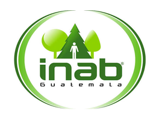
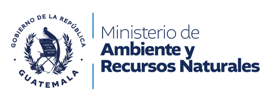
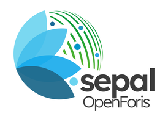
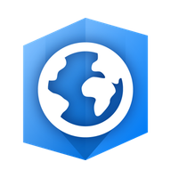
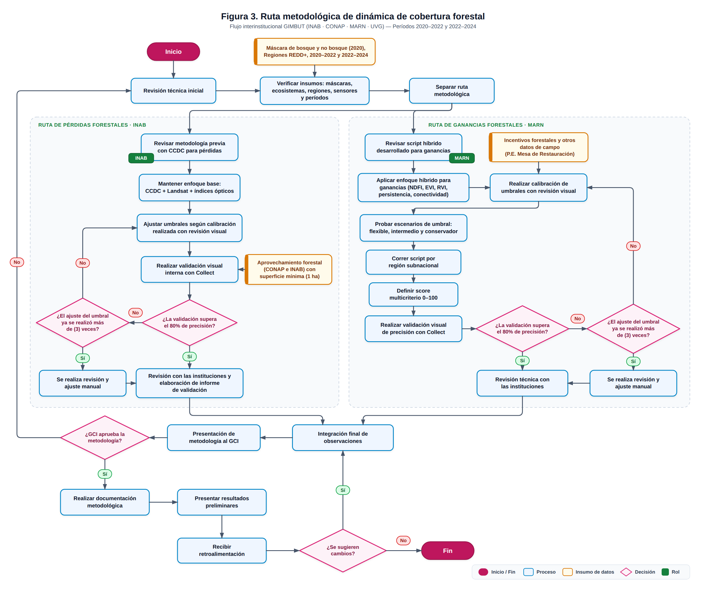

  <strong>Mapa de Dinámica de la Cobertura Forestal de Guatemala (2020–2022 y 2022–2024)</strong> 
  Grupo Interinstitucional de Monitoreo de Bosques y Uso de la Tierra (GIMBUT)

  
  &nbsp;&nbsp;&nbsp;
  
  &nbsp;&nbsp;&nbsp;
  
  &nbsp;&nbsp;&nbsp;
  

---

  
  &nbsp;&nbsp;&nbsp;
  
  &nbsp;&nbsp;&nbsp;
  
  &nbsp;&nbsp;&nbsp;
  

---

Repositorio técnico con los códigos, parámetros y flujos geoespaciales utilizados por **GIMBUT (INAB, CONAP, MARN y UVG)** para mapear la dinámica de la cobertura forestal nacional en los períodos **2020–2022** y **2022–2024**, a partir de la línea base 2020 y segmentado por las cinco regiones REDD+ de Guatemala.

## Flujo Metodológico

| Componente | Plataforma | Descripción |
| :--- | :--- | :--- |
| **Pérdidas forestales** | SEPAL (GEE) | Detección continua con **CCDC** sobre series Landsat 8 y 9 (2016–2024) y umbrales por región REDD+. |
| **Ganancias forestales** | Google Earth Engine | Compuestos de época seca Landsat 8/9 y **Sentinel-1** (4 evidencias ópticas/SAR calibradas con prueba de Wilcoxon). |
| **Depuración y UMM** | ArcGIS Pro / ArcPy | Exclusión de usos no forestales (MAGA) y bosque seco; filtrado espacial a **UMM ≥ 0.5 ha** (5 píxeles). |
| **Validación y áreas** | AREA2 · Collect Earth Online | Muestreo aleatorio estratificado (Olofsson et al., 2014) interpretado con Sentinel-2 y Planet. |

## Scripts y Anexos

| Anexo | Archivo | Propósito | Enlaces externos |
| :--- | :--- | :--- | :--- |
| **Anexo 1** | [`Anexo_1_Estimacion_Muestras.js`](anexos/Anexo_1_Estimacion_Muestras.js) | Diseño muestral estratificado y tamaño de muestra (AREA2). | [Script GEE](https://code.earthengine.google.com/9b8c956c7271147e20ae3a46fc848d44) |
| **Anexo 2** | [`Anexo_2_Limpieza_Perdidas.py`](anexos/Anexo_2_Limpieza_Perdidas.py) | Mosaico nacional, reclasificación y limpieza de pérdidas (≥ 0.5 ha). | — |
| **Anexo 3.1** | [`Anexo_3_1_Limpieza_Ganancias.py`](anexos/Anexo_3_1_Limpieza_Ganancias.py) | Exclusión de usos no forestales (MAGA) y bosque seco en ganancias. | — |
| **Anexo 3.2** | [`Anexo_3_2_Limpieza_Pixeles_05ha.py`](anexos/Anexo_3_2_Limpieza_Pixeles_05ha.py) | Eliminación de parches de ganancia menores a 0.5 ha (`RegionGroup` / `Nibble`). | — |
| **Anexo 4** | [`Anexo_4_Parametros_Deteccion_Ganancias.js`](anexos/Anexo_4_Parametros_Deteccion_Ganancias.js) | Parámetros temporales y umbrales regionales de detección de ganancias. | [Extracción GEE](https://code.earthengine.google.com/07ac4bb3a41dd97fbe9c9c0afc7c9861) · [Colab v8](https://colab.research.google.com/drive/1yUQGXr6IiBvs2vLAhMI0NrbA5kCJd6ir?usp=sharing) · [GEE 2020–2022](https://code.earthengine.google.com/623f59573e3bcd275d61f6de18a5560d) |
| **Anexo 5** | [`Bosque_no_mapeado_2020_Embeddings.js`](anexos/Bosque_no_mapeado_2020_Embeddings.js) | Mapeo de bosque en 2020 dentro de la mascara no bosque. | — |
| **Complemento** | [`Centroides_Muestras_Area2.py`](anexos/Centroides_Muestras_Area2.py) | Generación de centroides y buffers de 5 m para evitar efecto borde. | — |
